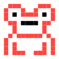

<p align="center">
  
</p>

<h1 align="center">Brag Frog</h1>

<p align="center">A daily workflow and check-in tool to log, reflect and grow your career.<br>Auto-prep 1:1s, log your work, and reflect on your impact.</p>

<p align="center">
  <a href="https://github.com/gruberb/brag-frog/blob/main/LICENSE">
    
  </a>
  <a href="https://github.com/gruberb/brag-frog/blob/main/CONTRIBUTING.md">
    
  </a>
  
  
  
  
  
</p>

## Features

- **Today**: upcoming meetings with join links, prep notes (optionally AI-drafted talking points), quick entry composer
- **Logbook**: contributions by week with filters (source, type, priority, team, person, search), bulk edit, and a Report button that saves the current filters as a downloadable report
- **Sync from 7+ sources**: GitHub, Phabricator, Bugzilla, Jira, Confluence, Google Drive, Google Calendar
- **Priorities**: department goals and priorities with status updates, tracking and Lattice CSV import
- **Review**: one document editor per self-review section, optional AI drafts (BYOK Anthropic API key), career level reference, export to Markdown, PDF or DOCX
- **Trends**: category distribution, priority share, code and ticket activity across a cycle
- **Settings** (gear icon): profile, cycles (including download), people, integrations, AI key
- **Quick navigation**: Cmd+K command palette and `g` shortcuts
- **Data ownership**: download any cycle as Markdown, PDF or DOCX; older check-in data stays readable per cycle

## Tech stack

moon monorepo with two apps:

- `apps/api`: Rust (Axum) + SQLite, JSON API under `/api/v1`, Google OAuth redirects. All API tokens encrypted at rest with AES-256-GCM.
- `apps/web`: React 19, TypeScript, Vite, React Router 7, TanStack Query, Tailwind v4, BlockNote. Types are generated from the Rust DTOs (ts-rs).

In production the API serves the built web app, so one container runs everything.

## Quick start

```bash
cp .env.example .env
# Fill in the required values (see below), then:
npm ci
moon run api:dev   # API on http://localhost:8080
moon run web:dev   # web app on http://localhost:5173 (proxies /api and /auth to :8080)
```

Requires [moon](https://moonrepo.dev), Node 24 (pinned in `.prototools`) and a Rust toolchain. Open `http://localhost:5173` while developing. To serve the web app from the API instead, run `moon run web:build` and open `http://localhost:8080`.

### Required env vars

| Variable | How to get it |
|---|---|
| `BRAGFROG_GOOGLE_CLIENT_ID` | [Google Cloud Console](https://console.cloud.google.com/apis/credentials): create an OAuth 2.0 Client ID |
| `BRAGFROG_GOOGLE_CLIENT_SECRET` | Same as above |
| `BRAGFROG_ENCRYPTION_KEY` | `openssl rand -base64 32` |

### Optional

| Variable | What it does |
|---|---|
| `BRAGFROG_INSTANCE_NAME` | Instance name shown on the sign-in page |
| `BRAGFROG_ALLOWED_DOMAIN` | Restrict sign-ups to a specific email domain (e.g. `your-company.com`) |
| `BRAGFROG_PUBLIC_ONLY` | Only sync public/non-confidential data (default: `false`) |
| `BRAGFROG_AI_MODEL` | Anthropic model for summaries (default: `claude-opus-4-7`) |
| `BRAGFROG_PORT` | Server port (default: `8080`) |
| `BRAGFROG_DATABASE_PATH` | SQLite database path (default: `bragfrog.db`) |
| `BRAGFROG_CONFIG_DIR` | Default TOML configs (default: `config`) |
| `BRAGFROG_CUSTOM_DIR` | Operator overrides (default: `custom`) |
| `BRAGFROG_WEB_DIST` | Built web app (default: `../web/dist`) |
| `SQLITE_JOURNAL_MODE` | SQLite journal mode; use `delete` for FUSE/NFS-backed volumes |

See [`.env.example`](.env.example) for the full list.

## Docker

```bash
docker build -t brag-frog .   # multi-stage: web app (node), API (rust), runtime (debian)
docker run -p 8080:8080 \
  -e BRAGFROG_GOOGLE_CLIENT_ID=... \
  -e BRAGFROG_GOOGLE_CLIENT_SECRET=... \
  -e BRAGFROG_ENCRYPTION_KEY=... \
  -v bragfrog-data:/data \
  brag-frog
```

### Docker Compose

```bash
cp .env.example .env   # edit with your credentials
docker compose up -d
```

Tagged releases are published as `ghcr.io/gruberb/brag-frog` by `.github/workflows/release.yml`. The container listens on 8080 and exposes `GET /healthz`.

## Deployment

See [docs/self-hosting.md](docs/self-hosting.md) for full deployment instructions covering:

- **Docker / Docker Compose**: recommended for most teams
- **Bare metal**: API binary + built web app
- **Fly.io**: with persistent volumes
- **Google OAuth setup**: step-by-step credential creation

## Customization

Brag Frog is configurable for any organization. Create a `custom/` directory next to where the API runs (`apps/api/custom` under moon, `/app/custom` in Docker) with your own versions of the config files:

| File | What it controls |
|------|-----------------|
| `clg_levels.toml` | Career ladder (levels, titles, competency descriptions) |
| `review_sections.toml` | Performance review sections and AI prompts |
| `services.toml` | Service URLs, default orgs, sync filters |
| `tokens.css` | Brand colors, fonts, CSS design tokens |

On startup, the API checks `custom/` first, then falls back to `config/` (`apps/api/config/` in the repo). `tokens.css` is the only file served to the browser (at `/custom/tokens.css`).

See [docs/customization.md](docs/customization.md) for details.

## Testing

```bash
moon run :lint :test :build   # api (clippy, cargo test) and web (eslint, typecheck, vitest, build)
```

API tests use in-memory SQLite, web tests use MSW. No external services needed.

## Dev docs

- [Getting Started](docs/getting-started.md): developer setup, running tests, common dev tasks
- [Architecture](docs/architecture.md): module map, request lifecycle, database design, sync architecture
- [Conventions](docs/conventions.md): entry system, data model, API and web conventions
- [Web app](apps/web/README.md): structure, boundaries, API mapping
- [CLAUDE.md](CLAUDE.md): conventions and gotchas for coding assistants

## License

[Mozilla Public License 2.0](LICENSE)
